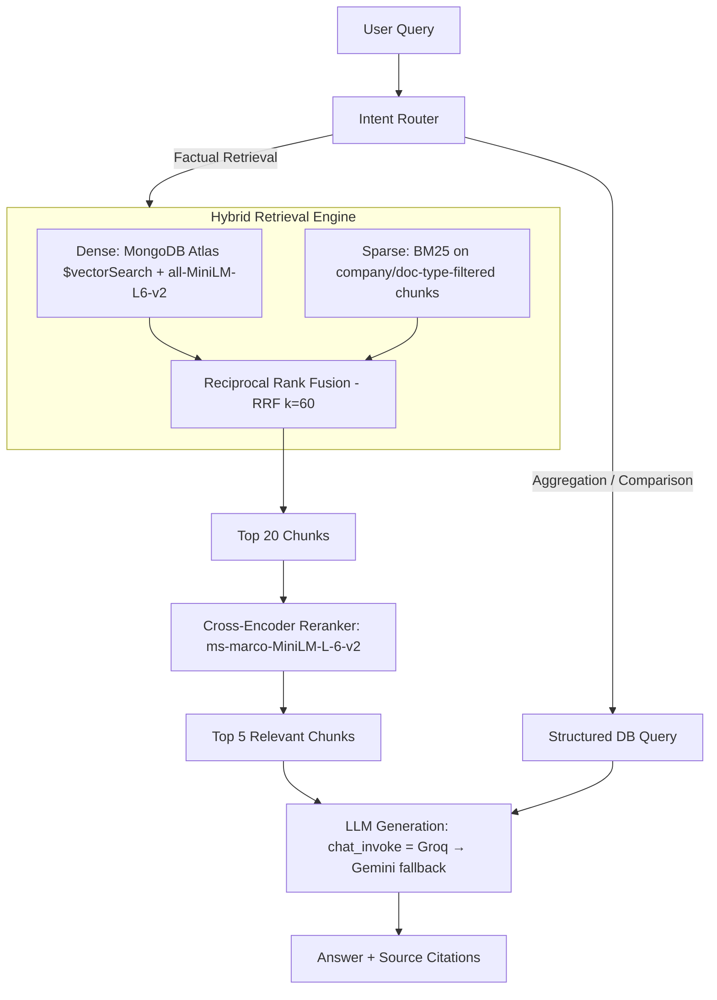
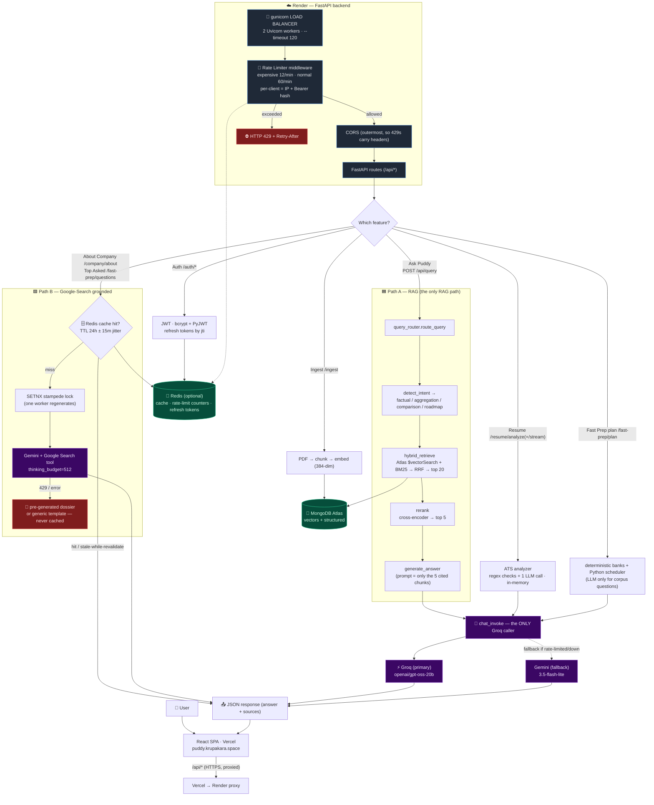
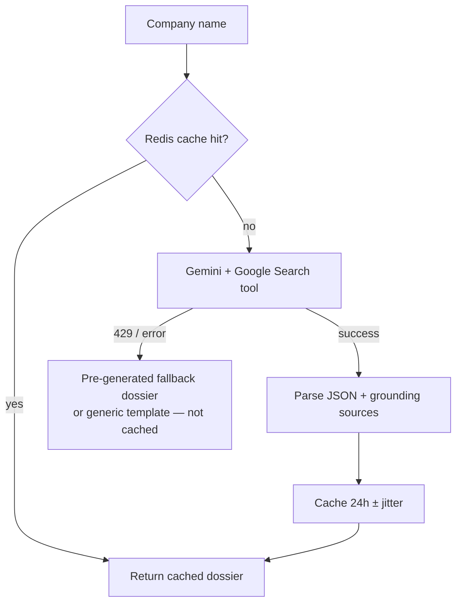
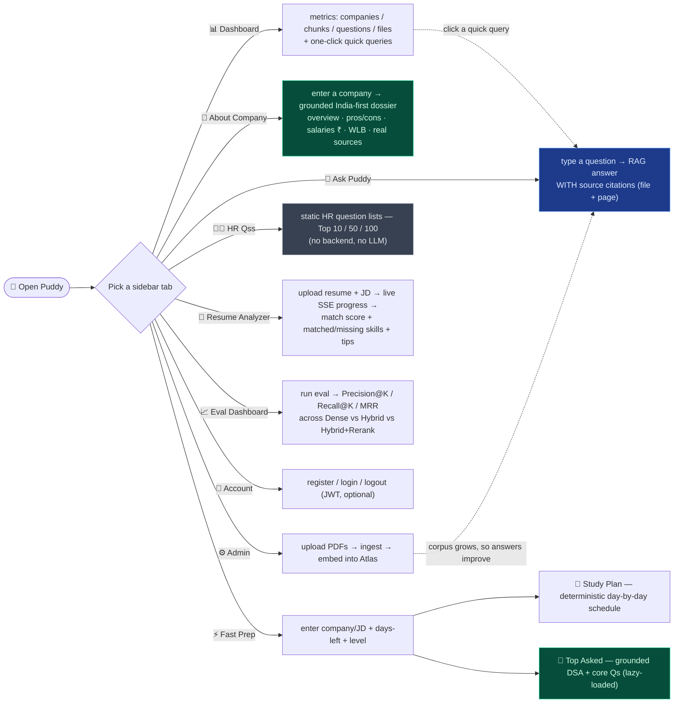

# 🐾 Placement Buddy Puddy (Puddy / PIA)

<p align="center">
  
</p>

<p align="center">
  <strong>An AI-powered placement-prep platform: a hybrid RAG pipeline for interview-experience Q&A, plus live Google-Search-grounded company research, resume ATS scoring, and day-by-day study plans.</strong>
</p>

<p align="center">
  
  
  
  
  
  
  
</p>

> **New here / confused about how the pieces fit?** Read **[HOW_IT_WORKS.md](./HOW_IT_WORKS.md)** —
> it explains, from the real code, exactly where RAG is used, where Groq vs Gemini are used
> and why there are two providers, what a "pre-generated fallback report" is, and what the
> rate limiter / load balancer / cache actually do.

---

## 📖 Table of Contents

1. [Overview](#-overview)
2. [The Two Answer Engines (read this first)](#-the-two-answer-engines-read-this-first)
3. [Application Tab Tour](#-application-tab-tour)
4. [Core Technical Architecture](#-core-technical-architecture)
5. [Tech Stack](#-tech-stack)
6. [LLM Providers: Why Groq *and* Gemini](#-llm-providers-why-groq-and-gemini)
7. [Production Infrastructure](#-production-infrastructure)
8. [Key Design Decisions](#-key-design-decisions)
9. [Quick Start & Setup](#-quick-start--setup)
10. [Production Deployment (Render + Vercel)](#-production-deployment-render--vercel)
11. [API Reference](#-api-reference)
12. [Project Structure](#-project-structure)

---

## 🔍 Overview

**Placement Buddy Puddy (Puddy)** is a data-driven placement-intelligence platform for
Indian students. It combines:

- A **hybrid RAG pipeline** (Atlas `$vectorSearch` + BM25 + cross-encoder rerank) over
  ingested interview-experience articles and job descriptions — this powers **Ask Puddy**.
  <sup>*(The hosted demo runs BM25-only — the dense/torch path is memory-gated on small
  Render tiers; see [Retrieval in production](#3-run).)*</sup>
- **Live Google-Search-grounded research** (Gemini + Google Search tool) for **About Company**
  dossiers and **Top Asked** interview questions — grounded in real, cited web sources.
- A **resume ATS analyzer**, a **deterministic Fast-Prep study planner**, and a **retrieval
  evaluation harness**.

It runs split-cloud: a React/Vite SPA on **Vercel** and a FastAPI service on **Render**,
backed by **MongoDB Atlas** (vectors + structured data) and optional **Redis** (cache,
rate-limit counters, refresh tokens).

---

## 🧭 The Two Answer Engines (read this first)

The single most important thing to understand: **there are two separate answer engines
that share almost no code.** Mixing them up is the root of most confusion.

| | **Path A — RAG engine** | **Path B — Grounded engine** |
|---|---|---|
| Feature | **Ask Puddy** chat | **About Company**, **Top Asked** |
| Reads from | your ingested PDFs (vectors in Atlas) | the live web (Google Search) |
| Technique | true RAG: embed → vector+BM25 → rerank → cite | Gemini Google-Search grounding |
| LLM | **Groq → Gemini fallback** (`chat_invoke`) | **Gemini only** (Groq can't search the web) |
| Status | **live** | **live** |
| Endpoint | `POST /api/query` | `POST /api/company/about`, `POST /api/fast-prep/questions` |

So a fast company answer you see in the UI is **Path B (grounded), not RAG**. RAG lives
only in Ask Puddy. Full details in **[HOW_IT_WORKS.md](./HOW_IT_WORKS.md)**.

---

## 🗺️ Application Tab Tour

The left sidebar exposes these workspaces:

### 1. 📊 Dashboard (`/`)
Central metrics: indexed **companies**, ingested **document chunks**, extracted
**questions**, processed **files**. Quick-query shortcuts and recently ingested companies.

### 2. 💬 Ask Puddy (`/query`)
The RAG chat. Ask about companies, DSA, salaries, or interview rounds and get answers with
**source citations** (PDF name + page) under strict anti-hallucination constraints. This is
the **only** feature that uses the RAG pipeline (backed by `POST /api/query`).

### 3. 🏢 About Company (`/companies`)
An **India-first, INR** company dossier — overview, India presence, pros/cons, salary ranges,
work-life balance — generated live by **Gemini + Google Search grounding**, with every claim
backed by real, cited web sources. Falls back to hand-written dossiers on quota errors
(see [pre-generated fallbacks](./HOW_IT_WORKS.md#4-what-is-a-pre-generated-fallback-report-for-amazon)).

### 4. ⚡ Fast Prep (`/fast-prep`)
Two sub-features in one tab:
- **Study Plan** — a **deterministic** day-by-day schedule built from curated core-subject
  and DSA banks (hard-coded, vetted LeetCode links), scaled by days-left and difficulty. The
  only AI part extracts company-specific questions from the ingested corpus.
- **Top Asked** — real DSA + core questions the company asks, via **Gemini + Google Search
  grounding** (loaded lazily so the plan stays fast).

### 5. 🧑‍💼 HR Qss (`/hr-questions`)
A **static, frontend-only** list of common HR questions (Top 10/50/100 views). No backend,
no LLM, no RAG.

### 6. 📄 Resume Analyzer (`/resume`)
Upload a resume PDF + a target JD PDF → **match score**, matched/missing skills, and
recommendations. Runs instant regex formatting checks + **one** LLM call (Groq→Gemini). Both
PDFs are processed **in memory and never persisted**. A streaming variant shows live progress
(extract → check → query → score) over Server-Sent Events.

### 7. 📈 Eval Dashboard (`/eval`)
Compares **Dense** vs **Hybrid** vs **Hybrid + Rerank** retrieval across **Precision@K,
Recall@K, MRR**, and LLM-as-judge **faithfulness** on labeled ground-truth Q&A pairs.

### 8. 🔐 Account (`/login`)
JWT register / login / logout. Auth is **optional** — feature routes stay public by design.

### 9. ⚙️ Admin (`/admin`)
The ingestion loader: upload experience sheets / JDs, run doc-type segmentation, embedding,
and Pydantic-validated entity extraction. This is what feeds the RAG corpus.

---

## 🛠️ Core Technical Architecture

**Path A — the RAG pipeline (Ask Puddy, `POST /api/query`):**



### 🧬 Full system architecture (end-to-end request lifecycle)

Every request enters through the same guarded funnel — **gunicorn load balancer → rate
limiter → CORS → routes** — then fans out to whichever engine the feature needs. This shows
the *whole* algorithm in one picture: where load is balanced, where requests get throttled,
where the LLMs are called, and where data lives.



**Path B — the grounded engine (About Company / Top Asked):**



### 🖱️ User navigation map (click-this → get-that)

What each sidebar tab is for, what you do there, and what comes back:



Legend: 🟦 blue = **RAG** (Ask Puddy) · 🟩 green = **grounded/web** (About Company, Top Asked) ·
⬛ grey = **static/no-LLM** (HR Qss).

---

## 💻 Tech Stack

| Component | Technology | Role |
| --- | --- | --- |
| **Frontend** | React 19, Vite, vanilla CSS | Glassmorphic SPA, SSE streaming client |
| **Backend** | FastAPI (async), Python 3.11+ | API, RAG orchestration, grounding |
| **LLM (text)** | **Groq** `openai/gpt-oss-20b` → **Gemini** `gemini-3.5-flash-lite` fallback | RAG answers, resume analysis, extraction |
| **LLM (grounded)** | **Gemini** `gemini-3.5-flash-lite` + Google Search tool | About Company, Top Asked |
| **Embeddings** | sentence-transformers `all-MiniLM-L6-v2` | 384-dim dense vectors |
| **Re-ranker** | cross-encoder `ms-marco-MiniLM-L-6-v2` | Top-20 → top-5 refinement |
| **Vector DB** | **MongoDB Atlas Vector Search** (`$vectorSearch`) | Chunk retrieval (index `vector_index`, 384-dim, cosine) |
| **Structured store** | MongoDB (JSON-file fallback) | Companies, questions, users, ingest log |
| **Cache / limits / tokens** | **Redis** (optional, degrades to no-op) | Grounded-result cache, rate-limit counters, refresh tokens |
| **Auth** | PyJWT + bcrypt | Access (30 min) + refresh (7 day) tokens |
| **Serving** | gunicorn + Uvicorn workers | 2-worker load balancing on Render |
| **Eval** | Custom harness | Precision/Recall/MRR + faithfulness |

---

## 🔀 LLM Providers: Why Groq *and* Gemini

Two providers exist because they cover each other's gaps:

1. **Groq can't search the web.** Grounded features *require* Google Search, which only
   Gemini offers → About Company / Top Asked stay on Gemini.
2. **Gemini's free text quota is small.** For plain text work (RAG answers, resume analysis,
   extraction) `chat_invoke` puts **Groq first** — it's fast and has a **separate** free
   quota — saving Gemini's limited quota for grounding (which draws from a *different*
   ~1.5K/day tool quota).
3. **Fallback = resilience.** If Groq is rate-limited or down, `chat_invoke` automatically
   falls back to Gemini lite. Two independent quotas pooled = far fewer hard failures.

`chat_invoke` ([`backend/rag/llm_client.py`](backend/rag/llm_client.py)) is the **only** place
Groq is used. Grounded features never call it.

---

## 🏗️ Production Infrastructure

- **Caching + stampede protection** ([`backend/cache/redis_cache.py`](backend/cache/redis_cache.py)):
  grounded dossiers / Top-Asked are cached with **TTL 24h ± 15min jitter**, a **SETNX
  regeneration lock** (only one worker regenerates on a miss), and **stale-while-revalidate**.
  Degrades to a no-op when `REDIS_URL` is unset. Error/fallback results are never cached.
- **Rate limiter** ([`backend/middleware/rate_limit.py`](backend/middleware/rate_limit.py)):
  per-client fixed window — **12 req/min** for expensive routes (LLM / grounded / ingest /
  auth), **60 req/min** otherwise. Client = forwarded IP + short Bearer hash. Redis-backed
  (global across workers) with an in-process fallback. Over-limit → **429 + Retry-After**.
- **Load balancer**: gunicorn runs **2 Uvicorn workers** (`-k uvicorn.workers.UvicornWorker
  -w 2 --timeout 120`) so one slow grounded call can't block others and crashed workers
  respawn; Render's router balances across scaled instances. This replaced the originally
  planned Kafka backbone.
- **Auth** ([`backend/auth/`](backend/auth)): bcrypt (SHA-256 pre-hash) + JWT; refresh tokens
  stored in Redis by `jti`, single-use rotation, revoked on logout. **Feature routes stay
  public**; attach `Depends(get_current_user)` to protect a route.

---

## ⚙️ Key Design Decisions

1. **Two engines, one app.** RAG for what we've ingested; live grounding for what we haven't
   (salaries, reviews, news). Grounding *is* RAG — just over the web as the corpus.
2. **Groq-primary text generation** to conserve Gemini's small free quota; Gemini-only for
   grounding because Groq can't search.
3. **Graceful degradation everywhere.** No Redis → cache/limits/tokens degrade to safe no-ops;
   Gemini 429 → pre-generated/generic fallback dossiers; no rerank model → passthrough.
4. **Deterministic Fast-Prep banks.** Study plans use curated, vetted question/DSA banks + a
   Python scheduler instead of trusting an LLM to enumerate — guarantees coverage and live links.
5. **Pydantic structured extraction** during ingestion; **RRF** fuses BM25 (exact terms like
   "SQL", "DFS") with dense semantics; **cross-encoder rerank** trims 20 → 5 to cut context.
6. **Privacy:** resume + JD PDFs are processed in memory and never persisted.

---

## 🚀 Quick Start & Setup

### 1. Environment

```bash
cd RAG_PROJECT
cp .env.example .env
```

Configure at least these in `.env` (all optional ones degrade gracefully):

```env
GOOGLE_API_KEY=your_gemini_api_key      # required for grounding + Gemini fallback
GROQ_API_KEY=your_groq_api_key          # primary text LLM (recommended)
USE_MONGODB=true
MONGODB_URI=your_atlas_connection_string
MONGODB_DB_NAME=pia_db
REDIS_URL=                              # optional: cache + rate limit + refresh tokens
JWT_SECRET=change-me                    # required only if you use auth
```

### 2. Backend

```bash
pip install -r requirements.txt
python -m backend.scripts.create_sample_data
python -m backend.ingestion.pipeline --data-dir ./data
```

### 3. Run

```bash
python -m backend.main
```

```bash
cd frontend && npm install && npm run dev
```

Backend docs: `http://localhost:8000/docs` · Frontend: `http://localhost:5173`

> **Atlas note:** dense retrieval needs an Atlas Vector Search index named `vector_index` on
> collection `vector_chunks`, field `embedding`, **384 dimensions, cosine** (create via the
> Atlas UI). Without it, retrieval falls back to BM25-only.

> **⚠️ Retrieval in production (the honest version):** the full **hybrid** pipeline
> (dense `all-MiniLM-L6-v2` embeddings + BM25 → RRF → cross-encoder rerank) runs end-to-end
> **locally** and on any instance with enough RAM. But `sentence-transformers` pulls in
> **PyTorch (~1 GB)**, which **OOMs Render's free / 512 MB tier** when the model loads. So for
> the hosted demo it's **deliberately commented out in [requirements.txt](requirements.txt)** and
> the app runs **BM25-only by design**: with torch absent the guarded imports fail cleanly,
> `similarity_search` returns no dense hits, the reranker passes through, and
> [hybrid_retrieve](backend/rag/retriever.py) answers from BM25 keyword retrieval instead of
> crashing. Ask Puddy stays up; results are keyword-matched rather than semantic. To enable full
> semantic RAG in prod, deploy the backend on a **≥ 2 GB Render tier**, **uncomment the
> `sentence-transformers` line** in `requirements.txt`, keep `WEB_CONCURRENCY=1` (so torch loads
> once), and create the Atlas `vector_index` above. This is a deliberate cost/quality trade-off,
> not a missing feature — the semantic path is fully implemented and gated only by memory.

### 4. Evaluation

```bash
python -m backend.eval.run_eval
python -m backend.eval.run_eval --faithfulness
```

---

## 🌐 Production Deployment (Render + Vercel)

Split-cloud: **React on Vercel** (static), **FastAPI on Render** (Python web service). Vercel
proxies `/api/*` to the Render backend (`vercel.json`).

### Backend on Render
A pre-configured [render.yaml](render.yaml) Blueprint runs:

```bash
gunicorn backend.main:app -k uvicorn.workers.UvicornWorker -w 2 --timeout 120 --bind 0.0.0.0:$PORT
```

Required env vars: `GOOGLE_API_KEY`, `GROQ_API_KEY`, `USE_MONGODB`, `MONGODB_URI`,
`MONGODB_DB_NAME`, and (recommended) `REDIS_URL`, `JWT_SECRET`.

#### Why dense embeddings are turned off on Render

The hosted backend runs on Render's **free tier (512 MB RAM)**. The dense half of the RAG
pipeline (`sentence-transformers` / `all-MiniLM-L6-v2` + the cross-encoder reranker) depends
on **PyTorch (~1 GB)**, which **exceeds that memory limit** — the deploy literally fails with
`Ran out of memory (used over 512MB) while running your code` when torch loads the model.

Rather than crash, we made a deliberate call: **`sentence-transformers` is commented out in
[requirements.txt](requirements.txt)** for this deploy. Every torch import is guarded, so with
it absent the app **degrades to BM25-only keyword retrieval** — `similarity_search` returns no
dense hits and the reranker passes through, so **Ask Puddy stays up and returns keyword-matched
answers** instead of 500-ing. The semantic path isn't missing, it's **gated by RAM**: uncomment
that one line and deploy on a **≥ 2 GB tier** (keeping `WEB_CONCURRENCY=1` so torch loads once)
to restore full hybrid dense + BM25 + rerank. Everything else — Google-grounded company
research, ATS scoring, study plans — is unaffected because it never touches torch.

### Frontend on Vercel
Import the repo; set `VITE_API_BASE_URL` to the Render URL if not using the `/api` proxy;
deploy. `vercel.json` handles SPA fallback routing and the `/api` → Render proxy.

---

## 🔌 API Reference

All routes are prefixed with `/api`.

### Features
- `POST /query` — **RAG** chat (Ask Puddy). *The only RAG endpoint.* e.g. `{ "query": "SQL questions", "company": "ProcDNA" }`
- `POST /company/about` — grounded India-first company dossier.
- `POST /fast-prep/plan` — deterministic study plan (+ corpus questions).
- `POST /fast-prep/questions` — grounded "Top Asked" questions.
- `POST /resume/analyze` — ATS resume analysis (single JSON).
- `POST /resume/analyze/stream` — same, as an SSE progress stream.

### Data / Admin
- `POST /ingest` — re-run ingestion on the server `./data` dir.
- `POST /ingest/upload` — upload PDFs, then ingest.
- `GET  /companies` — list ingested companies.
- `GET  /companies/{name}` — structured detail + questions for one company.
- `GET  /stats` — vector / structured / file counts.

### Evaluation
- `POST /eval/run` — run the retrieval eval harness.
- `GET  /eval/results` — last results.

### Auth
- `POST /auth/register` · `POST /auth/login` · `POST /auth/refresh` · `POST /auth/logout` · `GET /auth/me`

### Ops
- `GET /api/health`, `GET /health` — liveness (never rate-limited).

---

## 📂 Project Structure

```
RAG_PROJECT/
├── backend/
│   ├── main.py              # FastAPI entrypoint; registers rate limiter + CORS
│   ├── config.py            # Settings (models, Redis, JWT, rate limits) + env fallbacks
│   ├── ingestion/           # PDF load → chunk → embed → Atlas + Pydantic extraction
│   ├── rag/
│   │   ├── query_router.py  #   Path A: the ONLY RAG orchestrator (/api/query)
│   │   ├── retriever.py     #   hybrid retrieval (Atlas $vectorSearch + BM25 + RRF)
│   │   ├── reranker.py      #   cross-encoder rerank (20 → 5)
│   │   ├── generator.py     #   cited-answer generation
│   │   ├── llm_client.py    #   chat_invoke: Groq → Gemini fallback (only Groq caller)
│   │   ├── company_report.py#   Path B: grounded About Company + fallbacks
│   │   ├── interview_questions.py # Path B: grounded Top Asked + fallbacks
│   │   └── fast_prep.py     #   deterministic study-plan banks + scheduler
│   ├── cache/               # Redis cache: jitter TTL, stampede lock, SWR, token store
│   ├── middleware/          # Per-client fixed-window rate limiter
│   ├── auth/                # JWT: security / routes / deps (feature routes stay public)
│   ├── resume/              # In-memory ATS analyzer (+ SSE streaming)
│   ├── eval/                # Retrieval eval harness & metrics
│   ├── api/                 # routes.py (endpoints) + schemas.py (Pydantic models)
│   ├── db/                  # Atlas vector store + structured (Mongo/JSON) store
│   └── scripts/             # Sample PDF generator
├── frontend/                # React 19 + Vite SPA
│   └── src/{components,pages,services,data}
├── data/                    # PDF documents
├── render.yaml              # Render Blueprint (gunicorn + env)
├── vercel.json              # SPA fallback + /api proxy
├── HOW_IT_WORKS.md          # Deep walkthrough of the whole system
└── README.md
```
